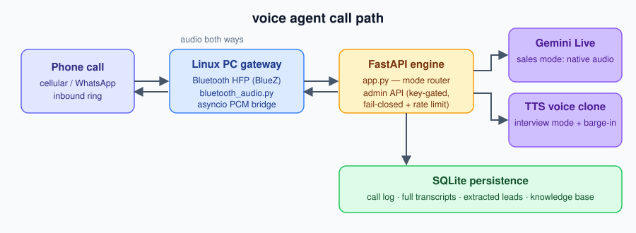

# WhatsApp AI Voice Agent

A real-time AI voice agent that turns your PC into a Bluetooth hands-free gateway: incoming phone/WhatsApp calls are answered by an AI agent (Gemini Live) that talks with the caller, captures leads, and logs every conversation.

## Features

- **Bluetooth HFP gateway** — your Linux PC pairs with an Android phone as a hands-free headset; calls ring through the agent automatically
- **Dual mode**:
  - `sales` — Gemini Live native audio (fast, preset voice)
  - `interview` — Gemini text → MiMo TTS voice clone (with barge-in / interruption handling)
- **Knowledge base** — inject company/product context so the agent answers accurately
- **Lead capture** — caller details extracted and stored (SQLite)
- **Call logging** — full transcripts persisted per call
- **Mode switching at runtime** via admin API

## Architecture



```
Phone (Bluetooth HFP) ⇄ bluetooth_audio.py ⇄ app.py (FastAPI + asyncio engine)
                                             ⇅
                              gemini_client.py (Gemini Live API)
                                             ⇅
                              elevenlabs_client.py (MiMo TTS, interview mode)
                                             ⇅
                              knowledge_base.py + call_logger.py (SQLite)
```

## Requirements

- Linux with BlueZ (Bluetooth stack) + `bluez-tools`
- Android phone paired via `bluetoothctl` (HFP profile)
- Python 3.11+
- Gemini API key (Google AI Studio)
- Optional: MiMo API key for voice-clone mode

## Setup

```bash
python3 -m venv .venv && source .venv/bin/activate
pip install -r requirements.txt

cp .env.example .env   # fill in your keys
python app.py          # sales mode
AGENT_MODE=interview python app.py   # interview mode
```

Pair Bluetooth first:

```bash
bluetoothctl
> power on
> scan on            # find your phone
> pair <MAC>
> trust <MAC>
```

## Admin API

All admin endpoints require `X-API-Key` header (set `ADMIN_API_KEY` in `.env`; fail-closed — endpoints return 501 if unset).

```bash
# List captured leads
curl -H "X-API-Key: $ADMIN_API_KEY" http://localhost:8765/api/leads

# Switch mode
curl -X POST "http://localhost:8765/api/mode?mode=interview" -H "X-API-Key: ***"

# Capture a lead
curl -X POST http://localhost:8765/api/leads -H "X-API-Key: ***" \
  -H "Content-Type: application/json" \
  -d '{"name":"Ali","phone":"+60123456789","company":"SME Sdn Bhd","notes":"follow up"}'
```

## Security

See [SECURITY.md](SECURITY.md) for the full threat model and route inventory.

- **Admin API key required** (`X-API-Key`, constant-time comparison) — no key configured = endpoints disabled (501, fail-closed)
- **WebSocket auth guard** — any WebSocket upgrade without a valid `?api_key=` is rejected before handlers run (fail-closed when `ADMIN_API_KEY` unset); no `/ws` routes exist today, the guard is defense-in-depth
- **Rate limiting** — 30 req/min per IP on admin endpoints
- **Security headers on every response** — CSP `default-src 'none'; frame-ancestors 'none'`, `X-Frame-Options: DENY`, `nosniff`, `no-referrer`, `Cache-Control: no-store`
- **Body cap** — 1 MB max request body (413 beyond)
- **Input validation** — mode whitelisted (`sales`/`interview`); lead payloads length-capped with control chars stripped; generic 500s never leak internals
- **No secrets in code or logs** — credentials via env vars only (`.env` gitignored); outbound URLs are operator-config constants (no user-supplied URLs → no SSRF surface)
- **PII local** — call logs and leads stay in your local SQLite DB; nothing is synced anywhere
- **CI** — pytest + bandit + pip-audit + gitleaks on every push (SHA-pinned actions)

> ⚠️ Run behind a reverse proxy with TLS if exposing the admin API beyond localhost.
> The default bind is `0.0.0.0:8765` — restrict with a firewall if not needed externally.

## systemd

`voice-agent.service` included — copy to `~/.config/systemd/user/`, adjust paths, then `systemctl --user enable --now voice-agent`.

## License

MIT
